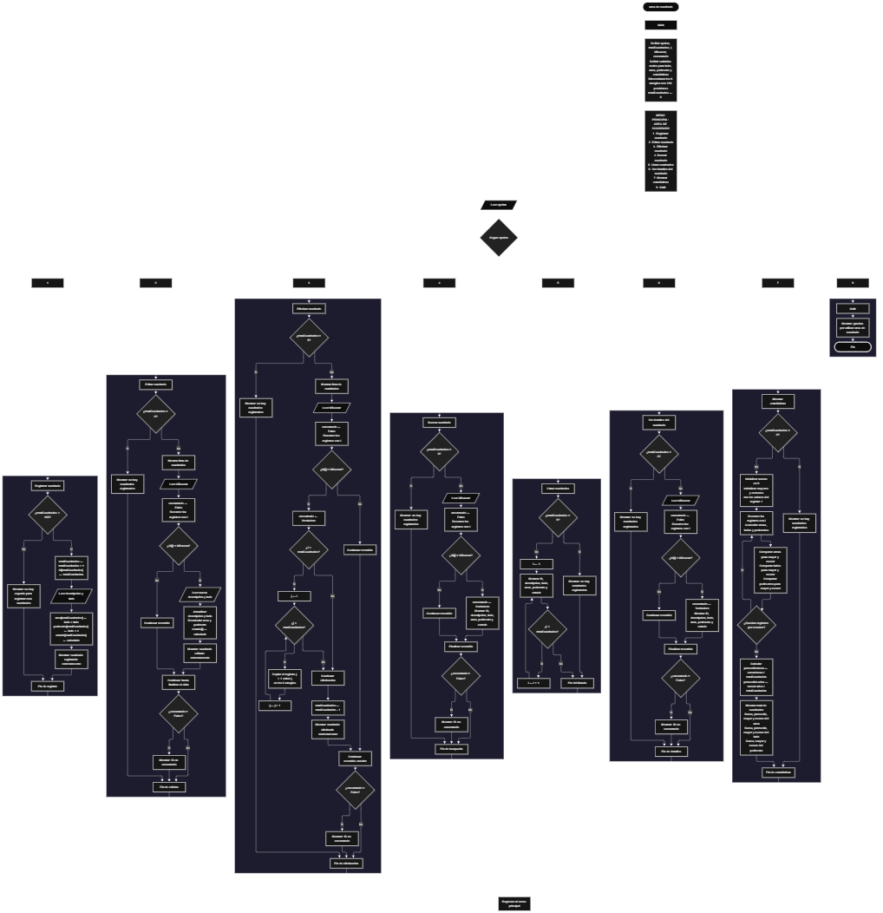

 

Este proyecto, llamado <b>área de cuadrado</b>, fue desarrollado en <b>pseint</b> como un ejercicio práctico para fortalecer la lógica de programación mediante la creación de un sistema de gestión de cuadrados desde la consola. El programa cuenta con un menú principal de ocho opciones que permite <b>registrar, editar, eliminar, buscar, listar, consultar información completa y mostrar estadísticas</b> de los cuadrados registrados. Cada cuadrado almacena datos como su identificador, descripción, lado, área, perímetro y estado, utilizando arreglos con una capacidad máxima de <b>100 cuadrados durante la ejecución</b>. Durante su desarrollo se aplicaron conceptos fundamentales de programación, como variables, arreglos, estructuras condicionales, ciclos repetitivos, estructuras de selección y operaciones para buscar, modificar, eliminar y organizar registros. Además, se implementaron fórmulas geométricas para calcular el área y el perímetro de cada cuadrado, así como procedimientos estadísticos para analizar los valores almacenados. Este proyecto permite poner en práctica los conocimientos adquiridos en PSeInt y sirve como base para desarrollar sistemas de gestión y cálculo matemático más avanzados.

<h2 align="center">⚙️ Funcionamiento del menú principal</h2>

### ➕ Registrar cuadrado

La opción <b>1) registrar cuadrado</b> permite registrar un nuevo cuadrado en el sistema. Antes de realizar el registro, el programa comprueba que la cantidad de cuadrados almacenados sea menor a <b>100</b>, utilizando la condición <b>totalCuadrados &lt; 100</b>. Si existe espacio disponible, la variable <b>totalCuadrados</b> aumenta en uno y el programa asigna un identificador mediante la instrucción <b>id[totalCuadrados] &lt;- totalCuadrados</b>. Después, solicita la <b>descripción y el lado</b> del cuadrado. Con estos datos calcula el área mediante la fórmula <b>lado × lado</b> y el perímetro mediante la fórmula <b>lado × 4</b>. Finalmente, almacena el estado <b>"calculado"</b> y muestra el mensaje <b>"cuadrado registrado correctamente."</b>. Si se alcanza la capacidad máxima, presenta el mensaje <b>"no hay espacio para registrar mas cuadrados."</b>, impidiendo agregar otro registro.

### ✏️ Editar cuadrado

La opción <b>2) editar cuadrado</b> permite modificar los datos de un cuadrado registrado. Primero, el programa comprueba si existen cuadrados almacenados mediante la variable <b>totalCuadrados</b>. Si no hay registros, muestra el mensaje <b>"no hay cuadrados registrados."</b>. En caso contrario, presenta una lista con el identificador, la descripción, el lado, el área, el perímetro y el estado de cada cuadrado. Después, solicita el ID del cuadrado que se desea editar e inicializa la variable lógica <b>encontrado</b> con el valor <b>falso</b>. Mediante un ciclo <b>para</b>, recorre los identificadores y compara cada uno con el valor introducido. Si encuentra una coincidencia, solicita la nueva descripción y el nuevo lado, actualiza el área y el perímetro, restablece el estado a <b>"calculado"</b> y muestra el mensaje <b>"cuadrado editado correctamente."</b>. Si no encuentra el identificador, presenta el mensaje <b>"no se encontró un cuadrado con ese id."</b>.

### 🗑️ Eliminar cuadrado

La opción <b>3) eliminar cuadrado</b> permite eliminar un cuadrado mediante su identificador. Primero, comprueba si existen registros. Si el total es igual a <b>0</b>, muestra el mensaje <b>"no hay cuadrados registrados."</b>. De lo contrario, presenta la información de los cuadrados y solicita el ID que se desea eliminar. La variable <b>encontrado</b> permite identificar si existe una coincidencia. Cuando encuentra el registro, el programa comprueba si su posición es anterior a la última posición ocupada mediante la condición <b>i &lt; totalCuadrados</b>. Si se cumple, utiliza el ciclo <b>para</b>, controlado por la variable <b>j</b>, para desplazar una posición hacia atrás los valores de los arreglos <b>id, descripcion, lado, area, perimetro y estado</b>. Después, disminuye <b>totalCuadrados</b> en uno y muestra el mensaje <b>"cuadrado eliminado correctamente."</b>. Si no encuentra el ID, presenta el mensaje <b>"no se encontró un cuadrado con ese id."</b>. El código no limpia explícitamente la última posición después del desplazamiento ni interrumpe el ciclo exterior al encontrar una coincidencia.

### 🔎 Buscar cuadrado

La opción <b>4) buscar cuadrado</b> permite localizar un registro mediante su identificador. Primero, el programa comprueba si existen cuadrados registrados. Si no hay datos, muestra el mensaje <b>"no hay cuadrados registrados."</b>. Si existen registros, solicita el ID del cuadrado e inicializa <b>encontrado</b> con el valor <b>falso</b>. A continuación, utiliza un ciclo <b>para</b> para recorrer los identificadores y compararlos con el valor introducido mediante la condición <b>id[i] = idBuscar</b>. Cuando encuentra una coincidencia, cambia la variable lógica a <b>verdadero</b> y muestra el identificador, la descripción, el lado, el área, el perímetro y el estado. Si termina el recorrido sin encontrar coincidencias, presenta el mensaje <b>"no se encontró un cuadrado con ese id."</b>. La búsqueda se realiza mediante el ID y no mediante la descripción.

### 📋 Listar cuadrados

La opción <b>5) listar cuadrados</b> permite visualizar todos los cuadrados registrados. Antes de mostrar los datos, el programa comprueba si <b>totalCuadrados</b> es igual a <b>0</b>. Si no existen registros, presenta el mensaje <b>"no hay cuadrados registrados."</b>. En caso contrario, muestra el encabezado <b>"datos registrados"</b> y utiliza un ciclo <b>para</b> para recorrer los registros desde la primera posición hasta el total actual. En cada repetición, presenta el ID, la descripción, el lado, el área, el perímetro y el estado. Esta opción permite consultar los datos almacenados sin tener que buscar cada cuadrado individualmente.

### 📄 Ver detalles del cuadrado

La opción <b>6) ver detalles del cuadrado</b> permite consultar la información de un cuadrado específico. Primero, comprueba si existen cuadrados registrados. Si no hay registros, muestra el mensaje <b>"no hay cuadrados registrados."</b>. De lo contrario, solicita el identificador e inicializa la variable <b>encontrado</b> con el valor <b>falso</b>. Después, recorre los arreglos mediante un ciclo <b>para</b> y compara cada ID con el valor introducido. Cuando encuentra una coincidencia, muestra los detalles por separado: <b>ID, descripción, lado, área, perímetro y estado</b>. Si no encuentra el registro, presenta el mensaje <b>"no se encontró un cuadrado con ese id."</b>. Esta opción ofrece una visualización individual de los datos almacenados de cada cuadrado.

### 📊 Mostrar estadísticas

La opción <b>7) mostrar estadísticas</b> permite analizar los valores de los cuadrados registrados. Primero, comprueba si existen registros. Si no hay cuadrados almacenados, muestra el mensaje <b>"no hay cuadrados registrados."</b>. En caso contrario, inicializa en cero las variables <b>sumaAreas, sumaLados y sumaPerimetros</b>. También inicializa los valores mayores y menores del área, del lado y del perímetro utilizando los datos del primer cuadrado. Después, recorre los registros mediante un ciclo <b>para</b>, acumula las sumas y compara cada medida con sus respectivos valores máximos y mínimos. Al finalizar, calcula el promedio del área y el promedio del lado dividiendo sus sumas entre <b>totalCuadrados</b>. Finalmente, muestra el total de cuadrados, la suma, el promedio, el valor mayor y el valor menor del área; la suma, el promedio, el valor mayor y el valor menor del lado; y la suma, el valor mayor y el valor menor del perímetro. Aunque se declara la variable <b>promedioPerimetros</b>, el código no calcula ni muestra el promedio del perímetro.

### 🚪 Salir del menú principal

La opción <b>8) salir</b> permite finalizar el ciclo del menú principal. Cuando el usuario selecciona esta opción, el programa muestra el mensaje <b>"gracias por utilizar area de cuadrado."</b>. El menú se encuentra dentro de una estructura repetitiva <b>repetir ... hasta que</b>, cuya condición final es <b>opcion = 8</b>. Por lo tanto, después de seleccionar la opción 8, el ciclo termina y el algoritmo finaliza su ejecución. Si el usuario introduce un número que no corresponde a ninguna de las opciones definidas, el bloque <b>de otro modo</b> muestra el mensaje <b>"opcion no valida."</b>.

<h2 align="center">🧠 Temas aplicados en el proyecto</h2>

### 📦 Variables

En este proyecto se utilizan variables para controlar la opción seleccionada en el menú, registrar la cantidad de cuadrados almacenados, recorrer los arreglos, identificar los cuadrados que se desean modificar o eliminar, comprobar si se encuentra un registro y calcular las estadísticas. También se emplean variables reales para almacenar las medidas geométricas, sus sumas, sus promedios y sus valores mayores y menores.

🔢 <b>Opcion:</b> Almacena la opción seleccionada por el usuario en el menú principal.

📊 <b>TotalCuadrados:</b> Controla la cantidad actual de cuadrados registrados.

🔄 <b>I:</b> Funciona como contador para recorrer los arreglos y acceder a los datos de cada cuadrado.

🔁 <b>J:</b> Se utiliza en el ciclo de desplazamiento de los registros durante la eliminación de un cuadrado.

🔎 <b>IdBuscar:</b> Almacena el identificador introducido por el usuario para localizar un cuadrado.

✅ <b>Encontrado:</b> Variable lógica que indica si se encontró un registro con el ID solicitado.

📐 <b>Lado:</b> Representa la longitud del lado de cada cuadrado.

📏 <b>Area y Perimetro:</b> Almacenan las medidas geométricas calculadas para cada registro.

📈 <b>SumaAreas, SumaLados y SumaPerimetros:</b> Acumulan los valores de las medidas para calcular sus sumas generales.

📉 <b>PromedioAreas y PromedioLados:</b> Almacenan los promedios del área y del lado.

🏆 <b>MayorArea, MenorArea, MayorLado, MenorLado, MayorPerimetro y MenorPerimetro:</b> Guardan los valores máximos y mínimos de cada medida.

### 🗃️ Arreglos

El programa utiliza seis arreglos con una capacidad de <b>100 posiciones</b> para almacenar los datos de cada cuadrado. Estos arreglos funcionan de manera paralela: la misma posición representa un único registro en todos ellos. Por ejemplo, los datos del primer cuadrado se encuentran en <b>id[1], descripcion[1], lado[1], area[1], perimetro[1] y estado[1]</b>. Esta organización permite registrar, editar, buscar, listar, eliminar y consultar la información de cada cuadrado, además de realizar los cálculos estadísticos.

🆔 <b>Id[100]:</b> Almacena los identificadores asignados a los cuadrados.

📝 <b>Descripcion[100]:</b> Almacena la descripción de cada cuadrado.

📏 <b>Lado[100]:</b> Almacena la longitud del lado de cada cuadrado.

📐 <b>Area[100]:</b> Almacena el área calculada de cada cuadrado.

📏 <b>Perimetro[100]:</b> Almacena el perímetro calculado de cada cuadrado.

📌 <b>Estado[100]:</b> Almacena el estado del registro, establecido como <b>"calculado"</b> al registrar o editar un cuadrado.

### 🔀 Estructuras condicionales

Las estructuras <b>si</b> y <b>sino</b> se utilizan para comprobar si existe espacio disponible antes de registrar un cuadrado, determinar si hay registros almacenados antes de ejecutar determinadas operaciones, verificar si el ID introducido coincide con un registro y decidir si es necesario desplazar datos durante la eliminación. También se utilizan para comparar las medidas y actualizar los valores mayores y menores en el cálculo de estadísticas. Estas condiciones permiten ejecutar diferentes instrucciones según el estado de los registros y los resultados de las comparaciones.

### 🔄 Estructuras repetitivas

El programa utiliza los ciclos <b>para</b> y <b>repetir ... hasta que</b>. Los ciclos <b>para</b> permiten recorrer los arreglos para mostrar, buscar, editar y consultar cuadrados, así como acumular valores y comparar las medidas durante el cálculo de estadísticas. En la eliminación, el ciclo controlado por <b>j</b> desplaza los datos posteriores hacia las posiciones anteriores. Por su parte, el ciclo <b>repetir ... hasta que</b> mantiene activo el menú principal hasta que la variable <b>opcion</b> toma el valor <b>8</b>.

### 🎯 Estructura según

La estructura <b>segun ... hacer</b> evalúa el valor almacenado en la variable <b>opcion</b> y ejecuta el bloque de instrucciones correspondiente. Las opciones del 1 al 8 permiten registrar, editar, eliminar, buscar, listar, ver detalles, mostrar estadísticas y salir. También se incluye el bloque <b>de otro modo</b>, que muestra el mensaje <b>"opcion no valida."</b> cuando el usuario introduce un valor que no coincide con las opciones disponibles.

### 🔢 Dimensionamiento de arreglos

La instrucción <b>dimension</b> establece una capacidad de <b>100 posiciones</b> para cada uno de los seis arreglos. La variable <b>totalCuadrados</b> comienza en cero y aumenta cuando se registra un cuadrado, mientras que disminuye cuando se elimina uno. Las operaciones recorren las posiciones comprendidas entre la primera y la última posición considerada ocupada según el contador. La capacidad máxima se comprueba durante el registro mediante la condición <b>totalCuadrados &lt; 100</b>.

### 📐 Cálculos geométricos

El proyecto aplica las fórmulas matemáticas fundamentales del cuadrado para calcular sus medidas a partir de la longitud del lado. El área se obtiene multiplicando el lado por sí mismo, mientras que el perímetro se obtiene multiplicando el lado por cuatro. Estos cálculos se realizan al registrar un cuadrado y se actualizan cuando se modifica su descripción o su lado.

📐 <b>Área:</b> Se calcula mediante la fórmula <b>área = lado × lado</b>.

📏 <b>Perímetro:</b> Se calcula mediante la fórmula <b>perímetro = lado × 4</b>.

### 📊 Análisis estadístico

El programa aplica operaciones estadísticas básicas para analizar los cuadrados registrados. Primero acumula las áreas, los lados y los perímetros. Después, compara cada valor con las variables que almacenan los máximos y mínimos correspondientes. Finalmente, calcula el promedio del área y el promedio del lado utilizando la cantidad total de registros. Los resultados permiten conocer las sumas, los promedios disponibles y los valores extremos de las medidas calculadas.

### 🔄 Reorganización de registros

Cuando se elimina un cuadrado que no ocupa la última posición, el programa copia los datos de cada registro siguiente sobre la posición anterior. Este procedimiento se aplica a los seis arreglos para mantener relacionados el identificador, la descripción, el lado, el área, el perímetro y el estado. Después, disminuye el contador <b>totalCuadrados</b>. En el código actual no se limpia explícitamente la última posición ni se interrumpe el ciclo exterior tras encontrar el registro; estos detalles deben tenerse en cuenta al describir el comportamiento real de la eliminación.

<h2 align="center">¿Cómo se implementaron las operaciones crud en el proyecto?</h2>

Las operaciones <b>crud</b> se implementaron mediante las opciones del menú principal. La operación <b>crear</b> corresponde a <b>registrar cuadrado</b>, donde se almacenan la descripción y el lado, y se calculan las medidas geométricas. La operación <b>leer</b> se realiza mediante <b>buscar cuadrado, listar cuadrados y ver detalles del cuadrado</b>, que permiten consultar la información almacenada. La operación <b>actualizar</b> corresponde a <b>editar cuadrado</b>, donde se modifica la descripción o el lado y se recalculan el área y el perímetro. Por último, la operación <b>eliminar</b> corresponde a <b>eliminar cuadrado</b>, que desplaza los datos posteriores y disminuye el total de registros. Toda la información se almacena temporalmente en los arreglos durante la ejecución del programa.

<h2 align="center">Diagrama de flujo del proyecto</h2>

<h2 align="center">🛡️ Validaciones del programa</h2>

### 📭 No existen cuadrados registrados

Esta comprobación se utiliza en las opciones de <b>editar, eliminar, buscar, listar, ver detalles y mostrar estadísticas</b>. El programa verifica si <b>totalCuadrados = 0</b> y, cuando no existen registros, muestra el mensaje <b>"no hay cuadrados registrados."</b>. De esta manera, evita continuar con las operaciones que necesitan información almacenada cuando el arreglo no contiene registros activos.

### ⚠️ Capacidad máxima alcanzada

Durante el registro, el programa comprueba la condición <b>totalCuadrados &lt; 100</b>. Si todavía hay espacio disponible, permite registrar un nuevo cuadrado. Si se alcanza la capacidad máxima, muestra el mensaje <b>"no hay espacio para registrar mas cuadrados."</b> y no permite agregar otro registro.

### ❌ Cuadrado no encontrado

En las operaciones de edición, eliminación, búsqueda y consulta de detalles, el programa inicializa la variable lógica <b>encontrado</b> con el valor <b>falso</b> y recorre los identificadores almacenados. Si encuentra un ID coincidente, cambia la variable a <b>verdadero</b> y ejecuta la operación correspondiente. Si termina el recorrido sin encontrar una coincidencia, muestra el mensaje <b>"no se encontró un cuadrado con ese id."</b>.

### 📐 Cálculo del área y del perímetro

El programa calcula automáticamente el área y el perímetro cuando se registra un cuadrado y cuando se edita su descripción o su lado. Utiliza las fórmulas <b>área = lado × lado</b> y <b>perímetro = lado × 4</b>. Sin embargo, el código no comprueba que el lado sea un número positivo, por lo que no existe una validación explícita para impedir el ingreso de cero o valores negativos.

### 🆔 Identificadores de los cuadrados

El identificador se asigna utilizando el valor actual de <b>totalCuadrados</b> después de incrementarlo. Como consecuencia, tras eliminar un cuadrado, el siguiente registro puede recibir un identificador que ya se había utilizado anteriormente. El código no utiliza una variable independiente para generar identificadores únicos permanentes.

### ⚠️ Opción inválida

La estructura <b>segun</b> incluye un bloque <b>de otro modo</b> que muestra el mensaje <b>"opcion no valida."</b> cuando el valor introducido no coincide con ninguna de las opciones del menú. La opción <b>8</b> está definida para salir y coincide con la condición final del ciclo, por lo que permite terminar la ejecución del menú.

### 💾 Almacenamiento temporal

Los datos se guardan en arreglos durante la ejecución del algoritmo. El programa no contiene instrucciones para guardar los registros en archivos ni en una base de datos. Por ello, la información almacenada no se conserva automáticamente cuando finaliza la ejecución.

<h2 align="center">🎯 Objetivo del proyecto</h2>

El objetivo principal de este proyecto es fortalecer la <b>lógica de programación</b> mediante el desarrollo de un sistema de registro y análisis de cuadrados en <b>pseint</b>. A través de su construcción se aplican conocimientos sobre variables, arreglos, estructuras condicionales, ciclos repetitivos y estructuras de selección, integrándolos con fórmulas geométricas y operaciones estadísticas. Además, el proyecto permite comprender cómo registrar, consultar, modificar y eliminar información, mantener organizados los registros mediante arreglos paralelos y analizar los valores calculados. De esta manera, constituye una base práctica para desarrollar sistemas de gestión y aplicaciones matemáticas más completas utilizando otros lenguajes y tecnologías.

